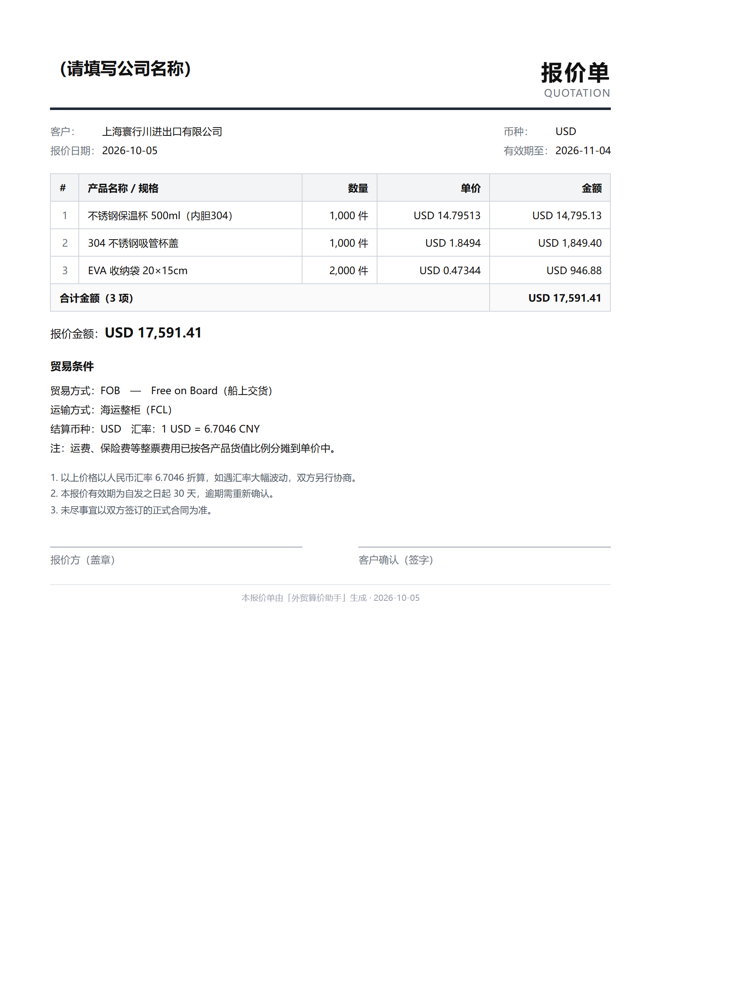
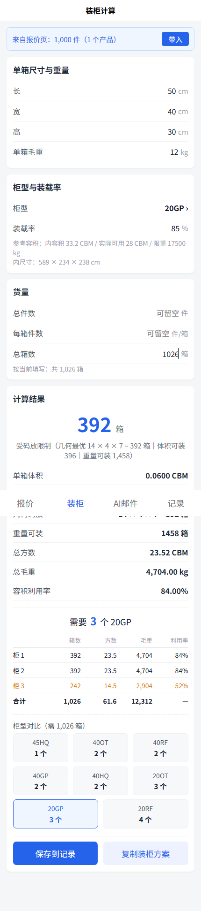
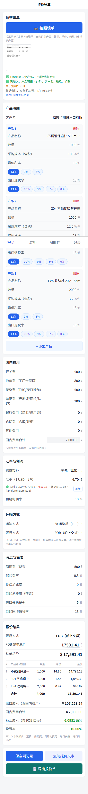
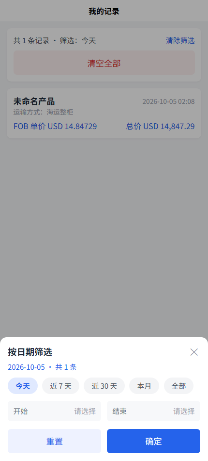

# 外贸算价助手 · Foreign Trade Quote Assistant

> 面向中小外贸业务员的一站式报价工具：**算价 → 报价单 → 装柜方案**，微信小程序 + H5 双端。
> 一个从需求定义到双端交付全部由「一个人 + AI 编程工具」完成的实战项目。


<details>
<summary><b>English summary</b></summary>

A quotation tool for small export businesses, shipped as a WeChat Mini Program and an H5 app from a single
uni-app codebase. It covers the full workflow: cost calculation with export tax rebates, all 11 Incoterms 2020
terms, live FX for 25 currencies, AI vision that turns a photo of a purchase order into a filled-in form,
headless-rendered PDF/PNG quotations, and a container-loading planner with geometric packing search.

Notable engineering details: cross-source FX precision picking (removes up to 16% error on low-value currencies),
an enforced "unit price × quantity = line amount" money model with adaptive decimal precision, and 500+ assertions
plus Puppeteer browser E2E used to verify AI-generated code before every commit.

Backend (Node.js, DeepSeek API): see [`trade-quote-backend`](https://github.com/<your-github-username>/trade-quote-backend).

</details>

---

## 截图

| 报价单（自动生成 PDF/图片，可直接发客户） | 多柜装柜方案 |
| --- | --- |
|  |  |

| 拍照识别多产品明细 | 记录页日期筛选（贴边悬浮球） |
| --- | --- |
|  |  |

## 功能

**报价计算**
- 完整的 **Incoterms 2020 十一种贸易术语**（EXW / FAS / FOB / CFR / CIF / FCA / CPT / CIP / DAP / DPU / DDP），按运输方式自动过滤冲突术语（空运不出现海运专属术语），费用按术语分层计入并标注「本术语未计入哪些费用」
- 出口退税、增值税、7 项国内费用明细（报关 / 拖车 / 港杂 / 单证 / 银行 / 仓储 / 其他，合计自动累加）
- 换汇成本与盈亏率，低于成本/亏损标红并给出亏多少
- **多产品明细**：整票费用按货值比例分摊到每一行，每行「单价 × 数量 = 金额」且「合计 = 各行之和」
- **手动定价**：直接填卖价，反算成本加成率、换汇成本、盈亏率
- 25 种货币实时汇率（多源交叉校验 + 跨源精度择优），支持手动覆盖

**AI 能力**
- **拍照填单**：拍采购单 / 发票 / 装箱单，DeepSeek 视觉约 3 秒识别多产品明细（品名 / 数量 / 单价 / 税率 / 箱规），自动填表并同步装柜页；识别不到的字段明确回显，不编造数字
- **AI 邮件**：报价邮件 / 开发信 / 催款 / 跟进四套模板，流式输出

**单据输出**
- 服务端 Edge 无头渲染正式中英文报价单，**1.5 秒**生成 PDF（约 100 KB）与图片版
- 小程序内保存到相册 / 打开 PDF 转发客户，替代手工排版

**装柜计算**
- 按箱子长宽高在柜内的 **6 种摆法**枚举取最优，输出码放明细（如 `14 × 4 × 7 = 392 箱`）
- 可装箱数 = min(体积可装, 几何码放, 重量可装)，并明确指出受哪个限制
- **多柜方案**：填总件数 / 每箱件数 / 总箱数，算出需要几个柜、每柜装多少、末柜余量
- 8 种柜型（20GP / 40GP / 40HQ / 45HQ / 20RF / 40RF / 20OT / 40OT）自动对比所需柜数

**记录**
- 报价记录与装柜方案本地保存，可展开详情、删除、清空
- **按日期筛选**（快捷区间 + 自定义范围），入口是贴边半藏的可拖动悬浮球

## 架构

```
┌──────────────────────────────┐
│  微信小程序 / H5（同一套代码）  │   uni-app + Vue 3 + Vite
│  src/pages/{quote,loading,ai,history}
└───────────────┬──────────────┘
                │  HTTPS / REST
┌───────────────▼──────────────┐
│  Node.js 后端（trade-quote-backend）│
│  · /api/fx          实时汇率（多源择优 + 缓存）
│  · /api/parse-image  拍照填单（DeepSeek 视觉）
│  · /api/run-once     AI 邮件（DeepSeek Chat，SSE）
│  · /api/quote-doc    报价单 PDF/PNG（Edge 无头渲染）
│  · 限流（IP 30 次/5 分钟）+ 接口白名单
└──────────────────────────────┘
```

纯计算逻辑全部抽成无副作用的纯函数放在 `src/utils/`（`calc.js` / `incoterms.js` / `transport.js` / `currency.js`），页面只负责取输入、调函数、渲染，因此可以脱离 UI 直接用 Node 断言验证。

## 快速开始

```bash
npm install

npm run dev:h5              # H5 调试（默认 http://localhost:5174）
npm run dev:mp-weixin       # 微信小程序开发编译
npm run build:mp-weixin     # 小程序生产构建 → dist/build/mp-weixin
npm run build:h5            # H5 生产构建 → dist/build/h5
```

用微信开发者工具导入 `dist/dev/mp-weixin`（或生产包）即可预览；小程序端需在「AI 邮件」页设置后端地址。

### 自测（纯 Node，无需启动服务）

```bash
node scripts/verify-incoterms.mjs    # 十一种术语 + 多产品分摊 + 单价位数
node scripts/verify-manualprice.mjs  # 手动定价反算
node scripts/verify-loading.mjs      # 装柜码放 + 多柜
node scripts/verify-calc.mjs         # 基础计算
```

合计 **500+ 条断言**，覆盖金额口径、边界值（数量 0 / 汇率 0 / 货值 0）与「单价 × 数量 = 金额」等一致性约束。

## 几个值得说的实现细节

**1. 汇率精度：别用 4 位小数算越南盾**
早期用 4 位小数四舍五入，VND 汇率 `0.0003` 这类小币种会产生最大 **16%** 的报价误差。改为多数据源聚合（ECB / open.er-api / exchangerate-api）+ 跨源择优取最高有效位数，并对精度不足的币种在界面上显式提示。

**2. 金额口径：单价 × 数量必须等于金额**
多产品按货值比例分摊后，2 位小数四舍五入会让「单价 × 数量 ≠ 金额」，客户一眼就能挑刺。最终方案是**单价小数位自适应**：常规商品 2 位，低价大批量（如 0.47 × 20 万件）自动升到 4~6 位，同时保证每行乘得回去、合计等于各行之和。这一版修正了此前凑整导致 **20 万件订单少收 680 美元**的缺陷。

**3. 装柜：体积除法会高估**
`可用容积 ÷ 单箱体积` 忽略了箱子在柜内的实际码放。改为枚举 6 种摆法取最优后，默认参数下从 396 箱修正为 **392 箱**（`14 × 4 × 7`），更接近现场。

## AI 驱动开发（Vibe Coding）

本项目的开发方式本身就是一次实践：**写任务书 → 交给 AI 编程工具（Claude Code / Cursor）实现 → 独立验收 → 提交**。

- `docs/tasks/` 里保存了每一次功能迭代的**任务书**（需求、口径、约束、验收标准），可以清楚看到「人负责定口径和验收，AI 负责实现」的分工
- `scripts/verify-*.mjs` 是验收的落地方式：不靠肉眼，靠断言和 Puppeteer 浏览器端到端
- 实践中从 AI 产出里抓出并修正过三类业务口径错误：单价 × 数量对不上、大批量凑整少算钱、拍照识别把供应商当客户名

## 已知限制

- 装柜码放为几何最优估算，未考虑托盘、堆叠层数限制与「禁止倒置」等行业约束
- 报价单为单币种，未做多币种对冲或锁汇
- 小程序正式发布需替换 `src/manifest.json` 中的 AppID，并将后端域名加入 request/downloadFile 合法域名

## License

[MIT](LICENSE) © 2026
